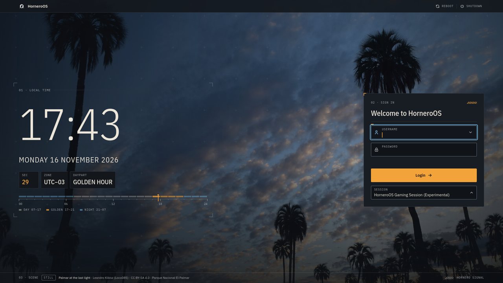

# Hornero Greeter (HorneroOS SDDM theme)

The HorneroOS login screen on **Hornero Signal** (RFC 0001,
`HorneroOS/docs/development/rfc-0001-hornero-signal.md`): a broadcast
control room over licensed Argentine footage. A telemetry clock framed with
registration marks sits on the left, one sign-in console on the right, and
two hairline rails carry the station ident, power actions, the credit of
the scene on screen and the current daypart. Fully offline.



The theme started as a Qt6 port of
[aerial-sddm-theme](https://github.com/3ximus/aerial-sddm-theme) by Fabio
Almeida; see [UPSTREAM.md](UPSTREAM.md) for provenance and
[NOTICE](NOTICE) for attribution. Backgrounds come from local media packs
(see [media/README.md](media/README.md)).

## Design (Hornero Signal)

The visual direction is **Signal Bezel** (`HorneroOS/docs`
`development/signal-visual-language.md`): instrument modules, sunken
readout wells, channel eyebrows and on-air chips.

- **Palette** — Signal Night roles from RFC 0001 §3.2 with amendment 2
  (`ruleStrong` `#707A85`, optional `glow`), verbatim, in
  `components/Signal.js`; `highContrast=true` switches to Signal High
  Contrast. The greeter runs as the `sddm` user before any session exists,
  so it carries the factory palette instead of reading the user's live
  scheme. Amber `signal` marks the one primary action and live values;
  celeste `focus`/`cue` marks keyboard focus.
- **Instruments** — the clock module shows the time in Plex Sans Condensed
  Light over three `sunken` readout wells (seconds, zone, daypart) with
  static scanlines, and a 24 h day scale. Every readout is a real value.
  The bottom rail carries an on-air chip: amber `LIVE` while licensed
  footage plays (the only glowing item: `glow` at 40 %, 4 px, static, off
  in High Contrast), outlined `STILL` otherwise.
- **Type** — IBM Plex Sans (UI), IBM Plex Mono (eyebrows, readouts,
  credits) and IBM Plex Sans Condensed (clock, date, console title), from
  the `ttf-ibm-plex` package. Numbers use tabular figures. If the package is
  missing, fontconfig falls back to the default sans and mono.
- **Geometry** — radius 3 for the console, wells and lists, 1 px `rule`
  hairlines inside surfaces, 1 px `ruleStrong` control boundaries, rails
  split into modules by short hairlines, one restrained shadow on the
  console, no blur and no glass. Lists are floating popouts with a 2 px
  signal notch facing their trigger; the selected row is a `signalWell`
  row with an `ACTIVE` eyebrow.
- **Signature details** — mono eyebrows with channel numbers
  (`01 · LOCAL TIME`, `02 · SIGN IN`, `03 · LIVE SCENE`), the 2×10 px
  registration tick on the focused console and control, a 2 px focus ring,
  a 24 h day scale that shows the theme's own day / golden-hour / night
  windows with a signal needle at the current time, and the La Plata 45°
  diagonal as a small hatch in the console header and bottom rail only.
- **Glyphs** — `components/Glyph.qml` draws the few Hornero Glyphs the
  greeter needs (Tabler Icons outline geometry, MIT) as vector strokes with
  the shell's `Glyph { name }` API. No icon font, no Material Symbols.
- **Motion** — the clock reveals once with a `sweep` clip over 480 ms plus
  6 px `settle` travel; the console wipes in with `sweep` and 6 px `enter`
  travel; lists open with 6 px `settleFast`. Settle curves move geometry
  only, never opacity or colour. `reducedMotion=true` sets spatial motion to
  0 ms and caps fades at 90 ms; the screen is complete with no animation.

## Dependencies

Qt6 (QtQuick, QtQuick.Effects, QtQuick.Shapes) + Qt 6 Multimedia with the
GStreamer backend, SDDM, GStreamer "good" plugins and IBM Plex:

- Arch: `pacman -S sddm qt6-multimedia qt6-virtualkeyboard gst-plugins-good ttf-ibm-plex`
  (+ `hornero-greeter-media-base` for the Argentina video pack; its package
  pulls in `gst-libav`, the H.264 decoder)
- Debian/Ubuntu:
  `apt install sddm qml6-module-qtmultimedia qml6-module-qtquick-virtualkeyboard qml6-module-qtquick-shapes gstreamer1.0-plugins-good fonts-ibm-plex`

## Installation

Clone and copy to `/usr/share/sddm/themes/hornero` (superuser needed):

```bash
git clone https://github.com/HorneroOS/greeter.git
sudo cp -r greeter /usr/share/sddm/themes/hornero
```

or install the `hornero-greeter` package (see `packaging/`). Select the
`hornero` theme in `sddm.conf`. Test without logging out:

```bash
sddm-greeter-qt6 --test-mode --theme <path-to-this-repository>
```

Hornero is a Qt 6 theme. Use `sddm-greeter-qt6` for previews; the unsuffixed
`sddm-greeter` may run Qt 5 and cannot load this theme.

The AUR publish workflow uses tags named
`pkg/hornero-greeter-vX.Y.Z`; distro composition tags cannot trigger it.
Arch `pkgver` does not allow hyphens, so prerelease labels use underscores in
the tag, for example `pkg/hornero-greeter-v1.1.0_preview1`. The tag determines
the package version, while the published PKGBUILD pins its Git source to the
verified release commit so a moved tag cannot change the build input. Preview
tags are stamped as `pkgver=1.1.0rc1` so Arch's version comparator orders the
preview before stable `1.1.0`.

The offline media pack has its own release flow. Attach
`hornero-greeter-media-base-X.Y.Z.tar.zst` to a published GitHub Release tagged
`hornero-greeter-media-base-vX.Y.Z`. The release workflow checks the asset
name, computes its SHA256, stamps the media PKGBUILD, and publishes only
`hornero-greeter-media-base` to the AUR. A theme tag does not republish the
media package; media updates remain tied to an explicit, versioned archive.
Follow [media/README.md](media/README.md) to fetch, verify, and build the
approved scenes; package them with `scripts/media/package.py --version X.Y.Z`.
Create the release from current `main`, attach the resulting
`dist/hornero-greeter-media-base-X.Y.Z.tar.zst`, then publish it. Preview tags
use `_previewN` and attach an archive whose package version uses `rcN` (for
example, `1.1.0rc1`).

## Media and credits

No network is used at runtime. If no local clip can play (or with
`videoEnabled=false`), the background falls back to a local still for the
current daypart. Local footage ships via media packs bridged under
`<theme>/media` (see [media/README.md](media/README.md) for the pack
format). The bottom rail names the scene on screen — title, place, creator
and licence — from `CREDITS` in the generated `media/catalog.js`.
`scripts/media/build-catalog` derives those credits only from the
rights-reviewed manifests of clips wired into `media/catalog.json` and from
the shipped stills, so a rights-pending candidate can never be credited or
shown.

## Changing settings in `theme.conf.user`

The package ships only `theme.conf`, which contains the working factory
defaults. `theme.conf.user` is an optional local override and is deliberately
not installed by the package. Create it beside `theme.conf` only when you
want to override selected values:

- `dayTimeStart`, `dayTimeEnd`, `goldenHourStart`, `goldenHourEnd` -
  day/night/golden-hour windows (also drawn on the day scale)
- `bgImgDay`, `bgImgGoldenHour`, `bgImgNight` - local fallback stills,
  supports animated GIF
- `videoEnabled`, `crossfadeDuration`, `testMode` - media playback behavior
- `largeText` - multiply greeter text and control sizes by 1.5 when true
- `highContrast` - switch to the Signal High Contrast palette when true
- `reducedMotion` - no spatial motion, fades capped at 90 ms, when true
- `virtualKeyboardAvailable` - show the on-screen keyboard toggle after the
  administrator enables Qt Virtual Keyboard in SDDM
- `virtualKeyboardEnabled` - show the on-screen keyboard at startup when true
- `dateFormat` and `timeFormat` - customize
  [date and time](https://doc.qt.io/qt-6/qml-qtqml-date.html) format
- `showLoginButton` - if false, hides the login button (Enter still logs in)
- `showTopBar` - if false, hides the top rail (ident and power actions)
- `autofocusInput` - focus the username (or password, when a last user is
  known) on show
- `brandingEnabled`, `brandingLogo` - the Hornero mark in the top rail

Colours, font families and sizes are Hornero Signal tokens, not
`theme.conf` keys. The pre-Signal keys (`displayFont`, `*FontColor`,
`*FontSize`, `relativePositionX/Y`, `passwordLeftMargin`,
`usernameLeftMargin`, `showClearPasswordButton`, `brandingAccent`) are no
longer read; remove them from an existing `theme.conf.user`.

Example `theme.conf.user`:

```ini
[General]
largeText=true
reducedMotion=true
```

The factory defaults keep large text, high contrast, reduced motion and the
on-screen keyboard off. SDDM's input method is a system-wide greeter
setting, so the package does not change it. To opt in on an X11 SDDM
greeter, copy
`/usr/share/doc/hornero-greeter/sddm-virtual-keyboard.conf.example` to
`/etc/sddm.conf.d/20-hornero-virtual-keyboard.conf`, set
`virtualKeyboardAvailable=true` in `theme.conf`, and restart SDDM. Set
`virtualKeyboardEnabled=true` too if the keyboard should open at startup.
SDDM's Wayland greeter clears `qtvirtualkeyboard`; use the compositor's own
keyboard support there. The runtime module is installed as a package
dependency, but it remains inactive unless the SDDM administrator opts in.

## Keyboard

- Tab / Shift+Tab: username → password → log in → session → keyboard
  layout → on-screen keyboard (when available) → restart → shut down,
  skipping hidden controls.
- Enter in either field logs in. Typing before a field has focus lands in
  the right field; the first keypress is never lost.
- Session and layout: Up/Down step through values; Enter, Space or
  Alt+Down open the list; Escape closes it and returns focus.
- Username: Down (or the chevron) opens the user list when more than one
  user exists.
- A failed login keeps the username, clears the password and refocuses it;
  Caps Lock is announced in the status line.

## Preview and screenshots

```bash
sh scripts/preview.sh                       # live window, fixture footage
sh scripts/preview.sh --grab /tmp/g.png     # offscreen 1920x1080 frame
sh scripts/preview.sh --grab /tmp/g.png --daypart night --power
sh scripts/preview.sh --grab /tmp/g.png --high-contrast --large-text
```

`--grab` renders the real `sddm-greeter-qt6 --test-mode` on Qt's offscreen
platform and has a staged copy of `Main.qml` save its own frame, so it
needs no display. Video frames are not captured offscreen (the still shows
through); use the live window with `--shot` for footage. Captures in
`screens/signal/` were produced this way; see `screens/signal/README.md`.

## License

The theme code is GPL-3.0 (see `LICENSE`). Media is independently licensed
per manifest and summarized in `NOTICE`, which also credits Tabler Icons
(MIT) for glyph geometry. IBM Plex (OFL-1.1) is a package dependency and is
not redistributed here.

## QML lint, format, and tests

- `sh scripts/qml-lint.sh` runs `qmllint` on every QML file and verifies
  `qmlformat` cleanliness (`FORMAT=1 sh scripts/qml-lint.sh` reformats).
- `python3 -m pytest tests/ -q` runs the unit suites: Hornero Signal
  contract (RFC palette values, WCAG contrast for every text and boundary
  pairing, Plex families, motion and reduced motion, no Material or legacy
  controls), keyboard accessibility, scene credits, catalog schema, the
  `theme.conf` contract, the `MediaCatalog.js` sequencer (via node), file
  permissions for the `sddm` user, and the `qmllint` gate. The same steps
  run in CI (`.github/workflows/qml.yml`, `media-pipeline.yml`).
