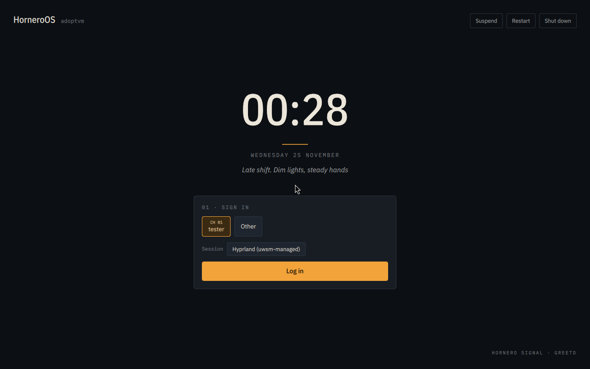
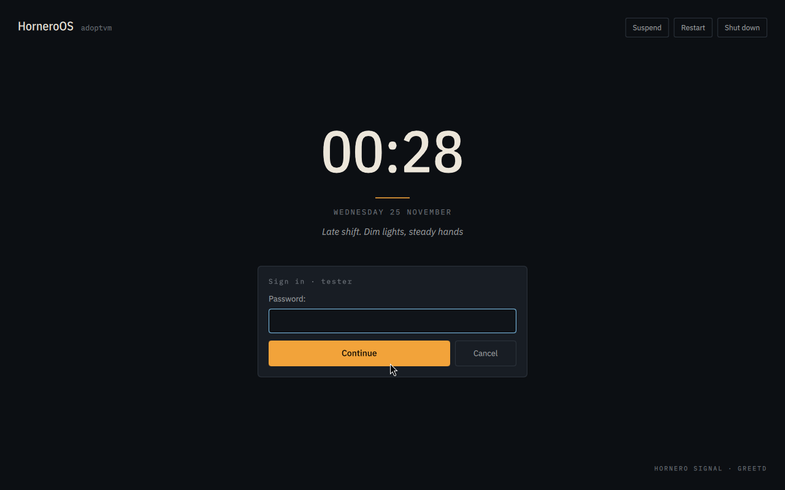
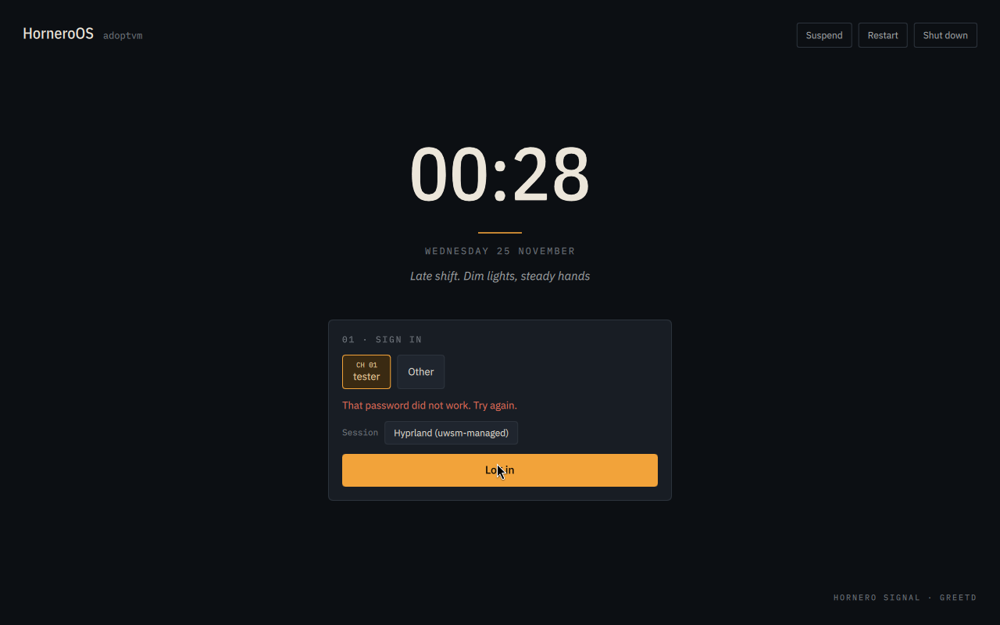

# Hornero Greeter (HorneroOS SDDM theme)

[](https://github.com/HorneroOS/greeter/actions/workflows/ci.yml)
[](https://github.com/HorneroOS/greeter/actions/workflows/qml.yml)
[](LICENSE)

The HorneroOS login screen on **Hornero Signal** (RFC 0001,
`HorneroOS/docs/development/rfc-0001-hornero-signal.md`). It is an original
instrument-panel sign-in from the same family as the shell's lock screen
(`HorneroOS/shell` `modules/lock`) and the reload-cover stand-by slate
(`reloadcover/`). The lock's centred clock and Javi's greeting sit above one
sign-in module, where user accounts are channels. The background is a quiet
Pampa horizon drawn in code. It works fully offline, and no photos or
videos are bundled.


<sub>The Hornero Greeter (SDDM) with demo accounts — not the Shell lock
screen.</sub>

See also: [HorneroOS/shell](https://github.com/HorneroOS/shell) ·
[Website](https://horneroos.com/) · [Docs](https://horneroos.com/docs/)

The theme started as a Qt6 port of
[aerial-sddm-theme](https://github.com/3ximus/aerial-sddm-theme) by Fabio
Almeida; see [UPSTREAM.md](UPSTREAM.md) for provenance and
[NOTICE](NOTICE) for attribution.

## Design (Hornero Signal)

The visual direction is **Signal Bezel** (`HorneroOS/docs`
`development/signal-visual-language.md`): instrument modules, sunken
wells, channel eyebrows and registration ticks.

- **Composition.** The top rail carries the station ident (the Hornero mark,
  `HorneroOS`, the host name) and the power actions. The centre column
  carries the clock and the sign-in module. The bottom rail carries the
  output name, the time zone and the `HORNERO SIGNAL` sign-off. When the
  column does not fit (for example large text at 1366×768), the clock moves
  to the leading side and the module to the trailing side. With the
  on-screen keyboard up, the module rises above it.
- **Clock.** This is the lock screen's clock. The numerals are Plex Sans
  Condensed Medium with tabular figures and a muted colon. One short
  signal hairline under the clock is the only glowing item (static, 40 %,
  4 px, off in High Contrast and on Day). Below it is the date in
  uppercase Plex Mono, then Javi, the hornero pixel sprite, with a greeting
  for the hour in the shell's cosy voice (`voice=plain` for the neutral
  one).
- **Sign-in module.** The `01 · SIGN IN` module has a registration tick and
  the La Plata hatch. Accounts are **channels**: `CH 01`, `CH 02`, and so
  on, each with an avatar (or an initial) and a name. The tuned channel is
  a signal-well tile with an on-air bar and a lit tally. An optional
  `Other` channel switches to a typed user name. Below the channels are the
  password well (named after the chosen account), the status line, the
  amber log-in button, and the session and keyboard-layout selectors. The
  session list shows what SDDM provides (for example HorneroOS Desktop,
  Studio and Gaming): stable sessions come first, experimental ones last
  with an `EXPERIMENTAL` chip, and an experimental session is never the
  default.
- **Background.** `components/HorizonField.qml` paints a striped half-set
  sun (the mark's sun-and-bars motif), a Pampa windmill and a wire fence
  on the skyline, a dial scale along the horizon like the slate's tuning
  well, furrows converging on the sun, and a sky of instrument ticks with
  three small constellations kept out of the centre column. It is painted
  **once** into a software Canvas image, and repaints only when the size,
  palette or seed changes. The sky is seeded by the host name and the date,
  so each machine gets its own sky and it changes from one day to the next
  (`backgroundSeed` pins it). Ambient motion is a single scan hairline that
  steps down the sky once per second. It turns off with reduced motion and
  High Contrast.
- **Palette.** The greeter runs as the `sddm` user before any session
  exists, so it cannot read a user's Control Center or Chromatic palette.
  `components/Signal.js` carries the built-in tables verbatim: Signal Night
  (RFC 0001 §3.2 with amendment 2, the default), Signal Day (from
  `HorneroOS/config` `profiles/themes/hornero-signal-day`) and Signal High
  Contrast. `colorScheme=auto` follows the platform light/dark preference
  (`Qt.styleHints.colorScheme`) only when SDDM's platform reports one, and
  otherwise stays on Night. Amber `signal` marks the primary action and the
  tuned channel. Celeste `focus` marks keyboard focus.
- **Type.** IBM Plex Sans (UI), IBM Plex Mono (eyebrows, readouts, status)
  and IBM Plex Sans Condensed (clock, titles), from `ttf-ibm-plex`. If the
  package is missing, fontconfig falls back to the default sans and mono.
- **Secondary outputs.** The main card is drawn only on SDDM's primary
  output (the `primaryScreen` context property). Every other output shows
  a quiet plate: the mark, the time and `SIGN IN ON THE MAIN DISPLAY`.
- **Glyphs.** `components/Glyph.qml` draws the few Hornero Glyphs the
  greeter needs (Tabler Icons outline geometry, MIT) as vector strokes.
  There is no icon font and no Material Symbols.
- **Motion.** The clock reveals once with a `sweep` clip over 480 ms. The
  module rises 6 px with an `enter` fade. Lists open with 6 px
  `settleFast`. Javi blinks every 7 s. Nothing runs continuously. With
  `reducedMotion=true`, spatial motion takes 0 ms, fades are capped at
  90 ms, the scan hairline and the blink stop, and the screen is complete
  without animation.

## greetd greeter (new)

`greetd/` holds a complete **graphical greeter for
[greetd](https://git.sr.ht/~kennylevinsen/greetd)** — a native Qt6/QML
program (`hornero-greetd-greeter`) that speaks the greetd IPC protocol
(`greetd-ipc(7)`) directly, runs fullscreen under
[cage](https://github.com/cage-kiosk/cage), and renders the same
Hornero Signal instrument panel as the SDDM theme (palette and copy are
embedded verbatim from `components/`, one source for both greeters).

- **Real PAM conversation.** greetd may ask any number of questions
  (password, one-time codes) and post notices; the UI renders each
  prompt (`visible`, `secret`, `info`, `error`) as it arrives, counts
  failed attempts, and never starts a session after an `auth_error`.
- **Users and sessions from the system.** Accounts are channels read
  from `/etc/passwd` (UID ≥ 1000, real shells; last account remembered);
  sessions come from `<datadir>/{wayland,x}-sessions/*.desktop` with
  stable entries first and experimental ones never the default.
- **Power via logind.** Suspend / Restart / Shut down appear only when
  logind's `Can*` answers "yes", and always ask first.
- **Honest offline state.** Without `GREETD_SOCK` the greeter shows its
  disconnected state instead of pretending to offer login.

Real-seat captures from the clean-Arch VM validation (greetd + cage on
seat0, QMP screendump, no fixtures):





```bash
cmake -S greetd -B greetd/build -G Ninja -DCMAKE_BUILD_TYPE=Release
cmake --build greetd/build -j2
# install as /etc/greetd/config.toml (see greetd/config/config.toml.example)
sudo systemctl enable greetd
```

Seat-validated in a clean Arch VM: real greetd + PAM completed a full
conversation (`Password:` → auth success → `start_session`), and the
greeter ran under cage with a logind greeter session on seat0 (DRM
modeset, Virtual-1). Two seat prerequisites were found the hard way
and are documented in `greetd/config/`: `/etc/pam.d/greetd-greeter`
must run `pam_systemd` (otherwise cage gets no seat), and the greeter
needs an `XDG_RUNTIME_DIR` (the example session wrapper creates one).

The C++ client is covered by protocol tests that run the real code
against a scripted greetd double (`tests/test_greetd_protocol.py`, CI
job `greetd.yml`): password flow, wrong-password `auth_error` (no
`start_session` ever sent) and a two-prompt conversation. AUR
packaging for `hornero-greeter-greetd` is defined in
`packaging/arch/hornero-greeter-greetd/` (published from
`pkg/hornero-greeter-greetd-v*` tags like the SDDM theme).

## Honest states

- **Wrong password.** The status line reads "That password did not work.
  Try again." with an alert glyph. From the second attempt on, it also
  gives the attempt number. The password is cleared and refocused, and the
  account stays selected.
- **Caps Lock.** "Caps Lock is on." is shown in signal amber with a glyph.
- **No sessions installed.** An alert tells people to ask the administrator,
  and log in and the session selector are disabled.
- **No user typed** (typed-name mode). The status line asks for a name
  first.
- **Daemon messages.** SDDM information messages are shown as they arrive.
  If the daemon does not answer within 12 s, the greeter says so instead of
  showing a spinner forever.
- **Power actions.** Suspend, Restart and Shut down each ask first: "Restart
  the computer now?" with Cancel focused. Escape or a click outside
  cancels. `confirmPower=false` skips the question.

Every status is announced as an accessible alert and carries words and a
glyph, never colour alone.

## Languages

The copy is in `components/Strings.js`, in English and Spanish (Rioplatense
voseo). The language follows the system locale SDDM runs with (`es_*`
gives Spanish), unless `language=en|es` forces one. Dates and times use the
same locale.

## Dependencies

Qt6 (QtQuick, QtQuick.Effects, QtQuick.Shapes, QtQuick.Window,
QtQuick.VirtualKeyboard), SDDM and IBM Plex:

- Arch: `pacman -S sddm qt6-declarative qt6-virtualkeyboard ttf-ibm-plex`.
  For an opt-in video background, also install `qt6-multimedia` and
  `gst-plugins-good`.
- Debian/Ubuntu (plus `qml6-module-qtmultimedia` for an opt-in video):

  ```bash
  apt install sddm qml6-module-qtquick-virtualkeyboard \
    qml6-module-qtquick-shapes fonts-ibm-plex
  ```

`hornero-greeter-media-base`, the retired Argentina video pack, is no
longer used. If it is still installed, the theme ignores it and you can
remove it.

## Installation

Clone and copy to `/usr/share/sddm/themes/hornero` (superuser needed):

```bash
git clone https://github.com/HorneroOS/greeter.git
sudo cp -r greeter /usr/share/sddm/themes/hornero
```

You can also install the `hornero-greeter` package (see `packaging/`). Then
select the `hornero` theme in `sddm.conf`. To test without logging out:

```bash
sddm-greeter-qt6 --test-mode --theme <path-to-this-repository>
```

Hornero is a Qt 6 theme. Use `sddm-greeter-qt6` for previews; the unsuffixed
`sddm-greeter` may run Qt 5 and cannot load this theme.

The AUR publish workflow uses tags named
`pkg/hornero-greeter-vX.Y.Z`; distro composition tags cannot trigger it.
Arch `pkgver` does not allow hyphens, so prerelease labels use underscores in
the tag, for example `pkg/hornero-greeter-v1.1.0_preview1`. The tag determines
the package version, while the published PKGBUILD pins its Git source to the
verified release commit so a moved tag cannot change the build input. Preview
tags are stamped as `pkgver=1.1.0rc1` so Arch's version comparator orders the
preview before stable `1.1.0`.

## Settings (`theme.conf.user`)

The package ships only `theme.conf`, which documents every key with its
factory default. `theme.conf.user` is an optional local override and the
package deliberately does not install it. Create it beside `theme.conf`
only when you want to change selected values:

- `colorScheme`: `auto` (platform preference when reported, else Night),
  `night` or `day`
- `highContrast`: the Signal High Contrast palette (wins over
  `colorScheme`)
- `largeText`: greeter text and controls at 1.5×
- `reducedMotion`: no spatial motion, fades capped at 90 ms, no ambient
  scan or blink
- `language`: `auto`, `en` or `es`
- `voice`: `cozy` (default) or `plain` greeting
- `mascot`: show Javi beside the greeting
- `background`: `horizon` (generative) or `plain` (flat ground)
- `backgroundMotion`: the 1 Hz ambient scan hairline on the main output
- `backgroundSeed`: an integer that pins the generative sky; empty means a
  new sky each day
- `backgroundImage`: **opt-in**, your own picture or video (an absolute
  path, or a path relative to the theme). Videos need `qt6-multimedia`, play
  muted and looped, and pause on the first frame with reduced motion. A
  missing or undecodable file keeps the generative horizon.
- `backgroundDim`: the ground wash over your own media, from 0.3 to 0.9
- `showUserChannels`: accounts as channels (false means a typed user name
  only)
- `allowOtherUser`: the `Other` channel for a typed user name
- `confirmPower`: ask before suspend, restart and shut down
- `virtualKeyboardAvailable` and `virtualKeyboardEnabled`: see below
- `dateFormat` and `timeFormat`:
  [Qt date and time formats](https://doc.qt.io/qt-6/qml-qtqml-date.html)
- `showLoginButton`: if false, hides the log-in button (Enter still logs
  in)
- `showTopBar`: if false, hides the top rail (ident and power actions)
- `autofocusInput`: focus the password (or the typed user name) on show
- `brandingEnabled` and `brandingLogo`: an optional logo file in place of
  the drawn Hornero mark (for example
  `components/resources/hornero-symbolic.svg`)

Example `theme.conf.user`:

```ini
[General]
colorScheme=day
largeText=true
backgroundImage=/usr/share/backgrounds/our-office.jpg
```

The retired media keys (`bgImgDay`, `bgImgGoldenHour`, `bgImgNight`,
`videoEnabled`, `crossfadeDuration`, `dayTimeStart`, `dayTimeEnd`,
`goldenHourStart`, `goldenHourEnd` and `testMode`) are no longer read. An
existing `theme.conf.user` that still sets them keeps working, because the
greeter ignores them. Colours, font families and sizes are Hornero Signal
tokens, not `theme.conf` keys.

The factory defaults keep large text, high contrast, reduced motion and the
on-screen keyboard off. SDDM's input method is a system-wide greeter
setting, so the package does not change it. To opt in on an X11 SDDM
greeter:

1. Copy
   `/usr/share/doc/hornero-greeter/sddm-virtual-keyboard.conf.example` to
   `/etc/sddm.conf.d/20-hornero-virtual-keyboard.conf`.
2. Set `virtualKeyboardAvailable=true` in `theme.conf`.
3. Restart SDDM.

Set `virtualKeyboardEnabled=true` too if the keyboard should open at
startup. SDDM's Wayland greeter clears `qtvirtualkeyboard`; use the
compositor's own keyboard support there. The runtime module is installed as
a package dependency, but it stays inactive unless the SDDM administrator
opts in.

## Keyboard

- Tab and Shift+Tab move through channels, the typed user name (when
  shown), password, log in, session, keyboard layout, the on-screen
  keyboard (when available), suspend, restart and shut down. Hidden and
  disabled controls are skipped.
- On the channels: Left and Right (or Up and Down) tune, Home and End
  jump, and Enter or Space move to the password. Typing goes straight to
  the password.
- Enter in the password logs in. Enter in a typed user name moves to the
  password. Typing before a field has focus lands in the right field, so
  the first keypress is never lost.
- Session and layout: Up and Down step through values. Enter, Space or
  Alt+Down open the list, and Escape closes it and returns focus.
- Power confirmation: Tab moves between Cancel and the action, and Escape
  cancels.
- A failed login keeps the account, clears the password and refocuses it.

## Preview and screenshots

```bash
sh scripts/preview.sh                          # live window (real models)
sh scripts/preview.sh --grab out.png           # offscreen 1920x1080 frame
sh scripts/preview.sh --grab out.png --scheme day --lang es
sh scripts/preview.sh --grab out.png --high-contrast --large-text
sh scripts/preview.sh --grab out.png --screens 2      # out.png + out-secondary.png
sh scripts/preview.sh --grab out.png --fail-login 2   # honest failure state
sh scripts/preview.sh --grab out.png --confirm restart
sh scripts/render-matrix.sh OUTDIR --sheet     # the whole review matrix
```

`--grab` renders the real `sddm-greeter-qt6 --test-mode` on Qt's offscreen
platform, so it needs no display. A staged copy of `Main.qml` saves its own
frame. Grabs use fixture accounts and sessions, a pinned clock (21:40) and a
pinned sky (seed 7), so frames are reproducible and show no real account.
`--host-models` uses the machine's real models instead. Probe flags only
edit the staged copy; the repository file is never modified. Run
`render-matrix.sh` through a resource cap on shared machines. The captures
in `screens/` were produced this way; see `screens/README.md`.

## License

The theme code is GPL-3.0 (see `LICENSE`). `NOTICE` credits Tabler Icons
(MIT) for glyph geometry. IBM Plex (OFL-1.1) is a package dependency and is
not redistributed here. The theme bundles no photographs or video. Earlier
releases shipped licensed Argentine footage and stills; their rights
records remain in the Git history.

## QML lint, format, and tests

- `sh scripts/qml-lint.sh` runs `qmllint` on every QML file and verifies
  `qmlformat` cleanliness (`FORMAT=1 sh scripts/qml-lint.sh` reformats).
- `python3 -m pytest tests/ -q` runs the unit suites:
  - the Hornero Signal contract (RFC palette values, Day from config, WCAG
    contrast on Night, Day and High Contrast, Plex families, motion and
    reduced motion, rationed glow, no Material or legacy controls)
  - the design contract (no continuous animation, slow timers, a
    background painted once, lock and slate family resemblance)
  - no bundled third-party media
  - keyboard and accessibility names, ES/EN string completeness
  - the `theme.conf` contract, packaging dependencies, file permissions
    for the `sddm` user, and the `qmllint` gate

  The same steps run in CI (`.github/workflows/qml.yml`, `ci.yml`).
